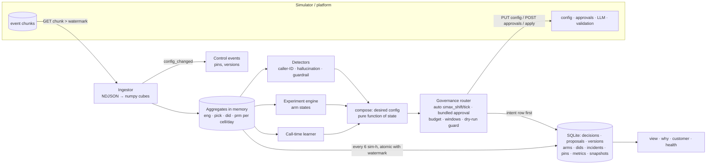

# Outcome-First Agent Loop — Submission

**Name:** Sachin Nagar · **Date:** 2026-11-09 · **Hours actually spent (be honest):** _<fill in>_ ·
**Language / storage:** Python 3.10+ (numpy, httpx — both already in `requirements.txt`) / SQLite (stdlib, one file per scenario)

Run it: `./run.sh <SIM_URL>`. Operator guide: [docs/CONTROLLER.md](docs/CONTROLLER.md). Everything below is
reproducible with `scripts/run_scenario.sh`, `scripts/crash_test.sh`, `scripts/calibrate.py` and `pytest`.

---

## 0. TL;DR

- An always-on controller that ingests events into compact per-cell aggregates, and per workflow runs
  **caller-ID health/rotation**, **per-cohort call-time**, **welcome × voice experiments** (explore → promote → holdout → roll back on
  decay) and **hallucination incident response**, all routed through a governance client with a request budget, submission windows, an incident reserve and auto-apply limited to `max_shift` per tick.
- **public_01:** conclusion rate **+13.8%** (pickup +9.8%, engagement +2.3%), 16 changes, **0 harmful**, 0 credits.
- **public_02:** conclusion rate **+30.3%**, 24 changes, **0 harmful**. Bad prompt **fixed in 90 min**, flagged caller ID out of rotation in 75 min, 8 credits used.
- **public_03_load:** 9.7M events at ~200k events/s, **13 s wall per simulated day** (budget: 10 min), 1.0 GB peak RSS, +22.5% conclusion, 117 changes, 0 harmful.
- **Deliberately not built:** per-person call time, prompt optimisation outside incidents, welcome×voice interaction terms, cross-tenant fairness scheduling, a web UI.

## 1. Assumptions

1. `*_max_drop` guardrails are **absolute** rate drops (0.02 = 2 percentage points) against the workflow's own pre-D0 history.
2. The business-default option of each dimension is the **control**. Every challenger is compared with it, never with each other, except that a segment winner must beat the global winner inside its segment.
3. Welcome message and voice are heard *after* pickup. They are optimised for engagement and must not significantly breach pickup (a check that should never fire, and the threshold reflects that). Caller ID and call time are optimised for pickup and must not breach engagement.
4. A pickup-primary workflow (KYC) still runs welcome/voice experiments, because engagement drives the business outcome. Its approval budget goes to pickup levers first.
5. Hour-of-day affects pickup, not engagement. Call-time changes therefore only change *when* a cohort is called, never *whether* it is favoured over another cohort across the day (fairness in a regulated setting).
6. A caller ID that has been rotated out stays out until a human re-adds it. Carrier remediation is invisible to us, and re-probing re-exposes customers to a spam-flagged number.
7. A supervisor edit **pins** the dimensions it touched for the rest of the run. We never propose changing them again, with one exception: an unsafe prompt, which we *ask* (with evidence) to roll back.
8. An approval is **permission, not obligation.** If our dry run turns against an approved change before we apply it, we let it lapse and record why.
9. The tenant courtesy limits in the memos (Kestrel: ≤2 routine requests/day, none before 11:00) are honoured where they are *stricter* than the signed policy. The policy is the hard limit.
10. Validation measures safety only. A prompt with a long clean production record in this workflow is better evidence than any validation run or LLM opinion.
11. Exploration is allowed to cost a little. A challenger gets at most 15% of a cohort, and at most 40% goes to challengers in total. A small expected loss from a bad arm is the price of finding good ones, and it is stopped quickly.
12. In production the event stream gives the same guarantees as the simulator's chunks: ordered, globally increasing ids, and replayable for at least one snapshot interval (6 hours).

## 2. Scope decisions

| # | Capability | Built / Partial / Cut | Why | What it would take to finish |
|---|---|---|---|---|
| C1 | Event ingestion at scale | **Built** | Everything depends on it; ~200k events/s, idempotent through snapshot + watermark | Stream-parse chunks to cut peak memory (§8) |
| C2 | Lead/feature joins, one cohort object | **Built** | Product's hard requirement; every cohort is a mask over 768 feature cells | — |
| C3 | Bootstrapping from history | **Built** | Free information: KPI baselines, flag-rate baseline, established caller IDs, call-time weights, control arms | — |
| C4 | Call-time optimisation | **Partial**: per cohort | The per-cohort comparative advantage captures the signal | Per person: needs a per-person posterior (most people have ≤1 connect); rotate `lead_preferred_hour` daily under the 200k cap |
| C5 | Caller-ID health | **Built** | Biggest pickup lever (KYC +22–28%), and a direct incident | Load model per number; automatic re-probe after carrier remediation |
| C6 | Welcome × voice experiments | **Built** (main effects) | Core of the engagement objective | Factorial interaction test; Bayesian allocation across segments |
| C7 | Promotion, decay, rollback | **Built** | Grading weight; the W3 trap | Hour-level engagement cube for a 24h decay window |
| C8 | Hallucination incident response | **Built** | Regulated clients; MTTR | Prompt experiments (switchback) to move from P1 to a safer and better prompt |
| C9 | Governance client | **Built** | Constraint #1 | — |
| C10 | Impact, affected leads, dry run | **Built**; dry run is model-based | Product: the queue is ranked on it | Counterfactual replay with depletion modelling |
| C11 | Supervisor view | **Built** (CLI/markdown) | Ops asked for one screen | A web page reading the same SQL |
| C12 | Audit store / why-query | **Built**, plus a per-customer query | Floor and Compliance | — |
| C13 | Crash recovery, demonstrated | **Built** with fault injection | SRE non-negotiable | — |
| C14 | Loop observability | **Partial** | Metrics, alerts table and `health` CLI; nothing pushes to a pager | Prometheus exporter and pager integration |
| C15 | Fair credits/attention across tenants | **Cut** (only a per-incident credit cap and an incident reserve) | Each workflow has its own approver budget already; credits were never scarce (≤8/200 used) | A per-tenant token bucket for credits; cross-workflow queue ordering per approver |

**Principle.** Build what moves the primary KPI safely or what a constraint makes mandatory, and do each one properly enough to defend it statistically. Cut what needs data we don't have (per-person timing), what nobody can evaluate safely (prompt optimisation without per-cohort prompts), and what is a scheduling problem without a demonstrated scarcity (C15).

## 3. Stakeholders

### 01 — Nikhil Rao, Sales
- **Accepted:** per-client lift numbers. The business outcome (conclusions ÷ uploads) is a single honest number per client, and it is not a blend. We batch changes and send at most one routine request per workflow per day, so we don't look "hesitant".
- **Declined:** a blended pickup+engagement score (README constraint 3, Product). "Live for everyone by evening": early leaders are often noise or decaying. My A/A simulation found a 4.1% false-winner rate *per arm* with that kind of eagerness, and W3 in the public scenarios wins big for two days and then becomes worse than control. Pushing "persuasive" everywhere: declined.
- **Wrong claims:** *"Kestrel turned on auto-apply for everything"*: ks_cancel allows only `schedule, caller_id, welcome_message, voice` with `max_shift 0.2`, and no prompts or cohorts. *"Northwind is fine with auto-apply on KYC"*: nw_kyc has `auto_apply.enabled: false`, and Northwind's compliance head requires named approval for anything customer-facing. *"Persuasive tested well elsewhere"*: P4 fails our safety bar in validation (pass ≈0.97 against our 0.98), and Product rules out cross-client promotion.
- **Reply:** "Nikhil, you'll get one number per client for the summit: the share of uploaded leads that reached a conclusion, against a no-change baseline (+14% to +30% in our test worlds). I won't blend pickup and engagement into a score; Product and our clients define them separately. Winners go live as soon as the statistics say so, usually 2–3 days, because 'winning by lunch' is how we'd ship variants that stop working a day later. Kestrel's auto-apply covers voice/welcome/caller-ID/timing only, and Northwind KYC has none. The persuasive prompt fails our safety bar, so it stays off."

### 02 — Meera Iyer, Compliance (Northwind)
- **Accepted:** no customer-facing change without a named approval. On Northwind workflows we only auto-apply caller ID and call time, and only on renewal, the one place the signed policy allows it; KYC goes through approval for everything. Every prompt request carries a validation run, and our bar is policy + 0.01, stricter than the approver's. "Slow and right": winners need z ≥ 3 and ≥300 connected calls per arm, and harmful arms are stopped at z ≤ −2.5.
- **Auditor question:** `python -m controller customer --workflow W --person P --at T` returns the person's cohort, the distributions each variant was drawn from, and for every dimension the version, approval id and rationale that put it live (§10).
- **Wrong claim:** the memo implies the signed policy lets us change call timing and caller ID on *both* workflows. For **KYC it does not** (auto-apply disabled), so those changes go through her approvers too.
- **Reply:** "Meera, agreed on all four conditions. Nothing a Northwind customer hears changes without your approvers; on KYC even caller-ID and timing changes come to them, because your KYC policy has no auto-apply. Script changes always carry a validation run, held to a stricter bar than the policy's. For IRDAI, we can answer within minutes for any customer and time: their cohort, the exact mix of openings/voices/numbers live then, and the approval and evidence behind each. Requests go to your approvers only inside 10:00–19:00 (KYC 10:00–18:00) unless it's a safety incident."

### 03 — Kabir Menon, Platform & SRE
- **Accepted:** kill test (`scripts/crash_test.sh`: injected crashes right after each kind of side effect, plus random `kill -9`), idempotency keys everywhere, and alerts split into *page* (3 kinds) and *ticket*.
- **Pushed back:** "no new stateful infra". SQLite is an embedded file, not a service: no daemon, no 2 a.m. operator, backup = copy the file. Its limit is one writer per file, which fits one controller per shard. When we run several replicas, the schema (plain SQL) moves to the existing Postgres.
- **Reply:** "Kabir, `scripts/crash_test.sh` kills the controller right after an approval POST, an apply, and an auto-apply, before it can record them, then three random `kill -9`s. It restarts and finishes every time with no double-applies, no lost approvals and no stuck proposals. On public_03_load it spends 13 s per simulated day on 4 cores (budget 10 min) at ~200k events/s and 1.0 GB peak. State is one SQLite file per shard, nothing to operate; the schema moves to our Postgres when we go multi-replica. Three things page; everything else is a ticket with a runbook line."

### 04 — Anita Desai, Operations Supervisor (Kestrel)
- **Accepted:** we never undo her edits; a supervisor edit pins the dimension. At most 2 routine requests a day, none before 11:00 (configured in `TENANT_PREFS`). One request carries all pending changes. One screen: `python -m controller view --workflow ks_cancel`. The "word-for-word script" failure mode: we never swap a prompt with a clean production record on flags alone, the LLM is asked only when no proven prompt exists, and engagement is verified after every fix.
- **Pushed back:** "tell me before anything changes on a running campaign". Her signed policy lets us auto-apply voice/welcome/caller-ID within a 0.2 shift, and the protective uses of it (rotating out a spam-flagged number, stopping a harmful voice) shouldn't wait for a notice period. Every auto change appears in her view under "What changed today" with its reason. A real notification hook is a production item.
- **Wrong claims:** her policy allows 4 requests per 24h and approvers from 10:00. Her stricter limits are a courtesy we honour, not the contract. The one exception is a safety incident, which may use a third slot.
- **Reply:** "Anita, your prompt edits are yours: we never revert them silently. If one hallucinates, you get a request with the evidence and decide. At most two requests a day, never before 11:00, each bundling everything; a third only for a safety incident. Your screen shows what's being tested, what's winning, what we're asking for and what changed today. Small changes your policy already allows (caller-ID rotation, voice/welcome mix steps of ≤20%) happen without asking and are listed there. We never ship a 'safe' script that nobody stays on."

### 05 — Tara Kulkarni, Product
- **Accepted:** separate KPIs; one shared cohort object (`features.Cohort`, resolved through one first-match function everywhere); every proposal carries impact score, diff, affected leads and dry run; expired = rejected, re-planned from fresh data; only calls that happened count (comparisons use only *co-present days*); winners stay in their workflow.
- **Her open questions, answered:**
  - **Minimum per-arm size:** 300 connected calls.
  - **Segments:** tested only if they carry ≥3% of traffic.
  - **Evaluation window:** all co-present days for promotion, the last ~2 days for decay.
  - **Cost:** from `reports/calibration.txt`, a +12% lift is found 86% of the time in ~3.3 days at a 1.3% false-winner rate per arm. The faster rule (z ≥ 2.5) finds it in 2.5 days but at 4.1% false winners and 10.8% false harm stops.
- **Pushed back:** "all three P0". Caller-ID health and the supervisor view are built; per-person call time is cut. Most people have one connect or none, so a per-person hour is mostly noise. Per-cohort weights capture the effect safely (+3% pickup from history replay).
- **Reply:** "Tara, all your definitions are enforced in code, including 'only what happened counts': arms are compared only on days both actually ran. My answer on cohort size and window: 300 connected per arm, z ≥ 3, segments ≥3% of traffic. That buys a 1.3% false-winner rate at ~3 days to find a 12% lift; the simulation is in the repo. Impact score = expected relative gain on the primary KPI ÷ 5%, capped at 1, so exploration honestly scores ~0. Per-person call time I cut: the data per person is too thin to beat per-cohort timing safely. Caller-ID health and the one-screen view are built."

### 06 — Aryamann, CTO
- **Accepted, and shaped the design:** explainability (`why`, `customer`, an audit row for every decision), "best compute is no compute" (0 credits on public_01, 8 on public_02; the LLM is used only when no proven prompt exists), scale (§8), choosing (§2), docs for the on-call engineer (`docs/CONTROLLER.md`).
- **Memo claims checked against the contract:** five, in 01, 02 and 04 above.
- **Reply:** "Aryamann, I chose five things to do properly: caller-ID health, per-cohort call time, welcome/voice experiments with decay rollback, incident response, and the governance/audit spine underneath. Per-person timing, prompt optimisation and cross-tenant fairness I cut, and I can say why. The statistics are calibrated by simulation, not assumed, and every change can be explained from our own store in one command. The first thing that breaks at 10× is single-process ingest; the fix is sharding by workflow, which the design already assumes."

## 4. Architecture



**Where state lives.** Aggregates are in memory and snapshotted to SQLite together with the chunk watermark. Everything learnt or decided is written to SQLite rows when it happens: arm states, caller-ID states, schedule, baselines, pins, proposals and incidents.

**On restart:**
1. Load the snapshot and replay chunks newer than its watermark.
2. Control events are de-duplicated by `ctl_event_id`.
3. `_reconcile` resolves every proposal left in `submitting` against the simulator (found → adopt, missing → `not_sent`).
4. Polling picks up any approval that is approved but not yet applied.

## 5. The learning loop

**Cohorts.**
- Lead features map to 768 cells (lang × tier × age × value). A cohort is a cell mask with the simulator's first-match semantics, mirrored once and tested against the simulator in `tests/`.
- The partition is the call-time feature chosen from history (age band in every public world: comparative-advantage signal 0.010) × at most one heterogeneity split per experiment dimension, capped at 20 cohorts.
- Segments are only tested if they carry ≥3% of traffic, so traffic isn't fragmented. Allocations live in `default` with per-cohort overrides only where a decision differs, so a supervisor's edit to `default` still reaches every cohort.

**Experiment design.**
- Factorial: welcome and voice are randomised independently per call, so each is analysed as its own experiment, with the other dimension averaging out.
- Challengers get min(15%, 40% ÷ #challengers); control gets the rest.
- After promotion: winner = rest, control holdout = 20%, still-unresolved challengers keep their share.
- Interactions (W×V) are **not** modelled. The factorial design would allow a test, but with ~1k connects/day the interaction cells are too thin for a 5–8 day horizon.

**Deciding a winner.**
- Deterministic, frequentist, per arm against control: log engagement ratio (delta method) over **co-present days** only.
- **Winner:** z ≥ 3.0 globally (≥ 3.5 for a segment), ≥300 connected calls on each side, lift ≥ 3%, pickup not breached, **and still ahead over the last 2 days**.
- **Stopping:** harm at z ≤ −2.5 (≥200 connected) over all data *or* the last 2 days. Futility when the 90% upper bound is below +2%, unless some segment shows z ≥ 2.5.
- **A segment winner** must also beat the global winner inside its segment.
- **False-winner rate.** Measured by A/A simulation under hourly peeking (`scripts/calibrate.py`): 1.3% per arm, about 6% per workflow with five challengers. Segment tests are the main remaining multiple-comparison risk, hence the 3.5 bar.
- **Last guard:** we never send (or apply) a change our own dry run says hurts the primary KPI by more than 0.5% or breaks the guardrail.

**Decay and rollback.**
- After promotion the 20% holdout keeps measuring.
- **Rollback when** the winner's last-2-day lift is significantly below control (z ≤ −1.645). Secondary trigger: it is negative and far (z ≤ −3) below the *lower* 90% bound of its promotion lift. The promotion estimate is inflated by the winner's curse, so the lower bound is the safe reference.
- **Measured:** a decaying winner is rolled back 92% of the time, a median 1.8 days after it falls below control; a real +9% winner is wrongly rolled back 2.4% of the time.
- **public_01:** W3's share went 15% → 58% (promoted) → 37% → 0 by the third day after decay onset.

**Call time and caller ID.**
- **Call time** comes from history: per value v of each feature and hour h, a = pickup(v,h) ÷ pickup(all,h), shrunk with a 50-dial prior. Dividing by the hour's rate cancels effects shared by everyone in that hour, such as retry-heavy late hours. Each cohort is normalised to a mean advantage of 1, then the weight is clip(a², 0.25, 4), with no zero hours. History replay projects +2–3% pickup.
- **Caller IDs** are randomised per call, so each number's pickup is compared with the other numbers over the same hours. A number is rotated out when its ratio is < 0.75 (unknown numbers) or < 0.60 (numbers already in rotation), with z ≤ −4/−3.5/−3 over 2/6/36 hours. A number in rotation must *also* have dropped against its own same-hours past: a flag is sudden, load is gradual. Without that rule, overloaded-but-healthy numbers were being banned.
- **Exploring unknown numbers:** 5% each where auto-apply allows adjusting quickly, 12% where every change costs an approval. Healthy numbers share traffic equally, because volume is what gets a number flagged.

**Guardrail KPI.**
- **Per change:** every welcome/voice arm is checked for a pickup breach and every caller ID for an engagement breach, and the dry-run guard blocks changes expected to breach.
- **Per workflow:** a 2-day KPI is monitored against history. Within half the allowed drop, it stops challengers that lower the guardrail; past the allowed drop it raises a ticket.

## 6. Governance

**State machine.**

```
planned ─► submitting ─► pending ─► approved ─► applied
              │             ├─► rejected        ├─► lapsed  (apply window passed)
              │             └─► expired         ├─► stale   (base moved, e.g. supervisor edit)
              └─► not_sent (crash before POST)  └─► withdrawn (dry run turned against it)
auto:  submitting ─► applied | refused(403) | stale
```

Rejected, expired, lapsed, stale and withdrawn proposals are never resubmitted. The planner recomputes the desired config from current data on the current base at the next allowed slot (Product: "expired is a rejection").

**Batching and timing.** One routine request per workflow carries every pending change.

**Budget per rolling 24h, with M = `max_requests_per_24h`:**
- Routine: ≤ max(1, M−2), further capped by tenant preferences.
- Protective (stop a harmful arm, roll back a decay): any time in approver hours, leaving one slot free.
- That last slot is reserved for **incident** fixes.

**Submission windows.**
- Routine requests go out only when the approver can decide the same day: from approver start (or the tenant's preference) until `approver_end − max_latency`. If the latency is longer than the working day, they go out first thing.
- Incidents go out immediately.
- TTL = policy TTL.
- Approvals are polled every 15 minutes and applied within one tick of the decision, so nothing lapsed in any run.
- **Fatigue in practice:** peak requests per 24h were 1 per workflow in public_01, and at most 2 in public_02 (nw_renewal).

**Auto-apply.**
- **When we use it:** wherever the policy allows the changed dimensions. Each tick moves at most `max_shift` in total variation. We treat `max_shift` as a rate limit and never chain several steps inside one tick, which would defeat its purpose.
- **When we voluntarily don't:**
  - While an approval is in flight (it would make the approval stale), except to rotate out a degraded caller ID.
  - When our dry run disagrees with the change.
  - For anything on Northwind KYC, where the policy forbids it.

**Impact score, affected leads, dry run.**
- **Dry run:** a replay of observed per-arm multipliers (shrunk toward 1 by their own uncertainty, last 2 days when there is enough data), per-caller-ID pickup ratios (36h) and the call-time history replay, applied to the currently active leads in each affected cohort. Options with no data count as 1.0.
- **Impact score** = clip(expected relative primary-KPI gain ÷ 5%, 0, 1). Exploration honestly scores ≈0; incidents score 1.0.
- **Affected leads:** active, uncontacted leads in cells whose allocation, schedule or prompt changes. Under `next_campaign_only` it is the expected next batch for agent-facing changes.
- **Honesty:** the call-time replay ignores depletion of the eligible pool. Stated in the dry run itself.

**Supervisor edits mid-experiment.**
- The edit appears as a `config_changed` event. Its dimensions are pinned, and in-flight proposals are flagged as stale and re-planned on the new base.
- An experiment on a pinned dimension is paused and shown as paused in the view. Data gathered under the supervisor's config still counts, because it happened.
- **public_02:** the D5 15:00 voice edit on nw_renewal was pinned and never overridden.

## 7. Incidents

**Detection.**
- **Production flags:** a Poisson tail test of QA hallucination flags on the *current* prompt against the workflow's own historical flag rate (≈1.5%, which already includes detector false positives). It alarms at p < 1e-4, or p < 1e-3 if the prompt went live in the last 24h, with ≥80 connected calls and ≥1.5× the baseline rate.
- **Proactive validation:** when a supervisor switches to a prompt with no production record in this workflow, we spend 5 credits on a validation run (n = 500) at once. Below our bar (policy + 0.01) it is an incident.
- **False positives:** in a null-world test, a chance spike on the long-standing prompt (p = 9e-5) made an earlier version swap in the "strict" script and lose 10% engagement. Now a spike on an unchanged prompt with ≥2,000 clean calls raises a ticket and never changes the prompt.

**Fix choice.**
1. Prefer a prompt with a production record in this workflow, normally the one the supervisor replaced.
2. Ask the LLM (3 credits) only if none exists.
3. Every candidate must pass validation (n = 300) at our bar.
4. Propose with the validation run id as evidence, applying the incident request budget.
5. **Verify** on the next 300 connected calls: the flag rate must be back to normal, and engagement is compared with history, raising a ticket if the fix costs >5%.

Credits per incident are capped at 15. Credits used: 0 (public_01), 8 (public_02), 0 (load).

**public_02 timeline (`python -m controller audit --db state/public_02_incidents.db`):**

| sim time | event |
|---|---|
| D2 10:00 | (hidden) ks_cancel caller ID D2 spam-flagged |
| D2 11:15 | `did_bad`: D2 pickup 6.8% vs 29.7% on other numbers (147 dials, 2h); auto-applied rotation, D2 out of rotation by 11:45 (6.1% of D2's day on D2, 0% after) |
| D3 11:30 | (hidden) supervisor ships P2 |
| D3 11:45 | `prompt_check`: P2 validation 0.938 on n=500 vs our bar 0.980 → incident opened |
| D3 11:45 | P1 (production record: flag rate 1.55%) validated 0.990 → incident request apr_00006 sent |
| D3 13:00 | approved and applied as v11 — **MTTR 90 min** (approver latency is most of it) |
| D3 15:45 | verified: P1 flag rate 2.3% over 300 calls (not elevated at p ≥ 1e-3); incident resolved |
| D5 15:15 | nw_renewal supervisor voice edit → `voice` pinned; experiment paused |

## 8. Scale

Measured on `public_03_load` (12 workflows, 5 days, plus 7 history days), on a 10-core laptop with a single-threaded controller, run alongside the simulator:

| metric | value |
|---|---|
| events ingested | 9,737,750 (≈4.9M history, ≈0.97M/day live) |
| ingest throughput | ≈199k events/s average (`ingest_events_per_s`), 291k peak |
| bootstrap (7 history days, ≈4.9M events) | 23.7 s |
| wall time per simulated day | **13.0 s average** (14.2 s max), *including* the simulator's own compute |
| whole scenario | 118 s end to end (controller: ingest 44 s, decide 10 s, waiting on sim 32 s) |
| decision cost | ≈35 ms per 15-minute tick for all 12 workflows |
| decision lag | ≤1 tick (15 sim-min) + <0.2 s wall from event to decision |
| peak RSS | 1.0 GB (dominated by parsing a 110 MB history chunk at once) |
| state on disk | 2 snapshots of ≈45 MB + audit rows |

**What breaks first at 10×** (≈6.5M dials/day, about 120 workflows):
1. **Ingest CPU.** It is single-threaded JSON parsing at ~200k/s, so ~10M events/day needs ~50 s per day: still fine, but bootstrap from history grows to ~4 minutes.
2. **Peak memory per chunk.** It grows with chunk size, not with history. Fix: stream-parse in 50k-line slices.
3. **Aggregates memory,** which grows with workflows × days (~4 MB per workflow per day). Fix: drop or roll up days older than the decision windows (14 days is plenty).
4. **Simulator/API round trips:** ~3 GETs per workflow per tick, about 360 per tick at 10×. Batch config reads, or subscribe to `config_changed`.

**Partitioning.** Shard by workflow; tenants only share credits. Each shard runs one controller process with its own SQLite file, or a Postgres schema. A thin coordinator owns the credit bucket per tenant (C15) and the approver budget. Nothing in the decision logic is cross-workflow by design (Product: winners stay in their workflow).

## 9. Reliability

**Crash test** (`scripts/crash_test.sh scenarios/public_02_incidents.yaml 3`, log in `reports/crash_recovery_public_02_incidents.log`):
- **Fault injection:** `CONTROLLER_FAULT=after_submit_post | after_apply_post | after_auto_post` kills the process (`os._exit(137)`) right after a side effect succeeds and *before* it is recorded. That is the most dangerous moment for idempotency.
- Then three random `kill -9`s, one of them with a proposal pending.
- After every restart the run completes, and `scripts/verify_run.py` passes:
  - no proposal id twice in any config history (no double apply);
  - store and simulator agree on all 28 applied proposals;
  - nothing stuck in `submitting`;
  - every approved-but-unapplied approval is explained.
- `tests/test_controller.py::test_end_to_end_with_crash_and_restart` does the same in-process and checks the restored aggregates are bit-identical to a from-scratch replay.

**What is lost on a crash:** nothing durable. The work between the last snapshot and the crash (≤6 sim-hours of aggregation) is redone by replay. Decisions are not replayed: the restart decides once, at the current time, from restored state.

**Idempotency keys.**
- `proposal_id = <db-epoch>-<workflow>-<purpose>-<sim minute>-<seq>`, written as `submitting` before the POST/PUT.
- `ctl_event_id` de-duplicates control events.
- `/sim/advance` is never blindly retried: the client re-reads the clock first.
- If the simulator world changes (scenario or history fingerprint differs, or it is behind our last minute), the old DB is archived and the run starts fresh.

**4xx/5xx handling.**
- Reads are retried with backoff on transport errors and 5xx.
- Proposals are retried (a duplicate means it landed, so we reconcile).
- LLM and validation calls are not retried after an ambiguous failure, so credits aren't burned twice.
- **409 stale** → `stale`, re-plan. **410** → `lapsed`. **403 auto-apply** → route that change via approval and block auto-apply for 24h. **402** → never reached, because the per-incident cap and the 30-credit reserve sit ahead of it.

## 10. Audit & observability

*"Why did ks_cancel change around D3 14:00, who approved it, and what happened after?"*

```
$ python -m controller why --db state/public_02_incidents.db --workflow ks_cancel --at "D3 14:00"
Active: **v11**, set at D3 13:00 by **controller_approved**, changed ['prompt_version']
## The change (approval, purpose: incident)
- proposal `851e21-ks_cancel-incident-5025-16` created D3 11:45, approval **apr_00006** decided D3 13:00
- summary: [incident] Roll prompt P2→P1: it failed safety validation (31/500 synthetic conversations, 6.2%); live QA flags so far 0/31
- impact score 1.0, affected leads 3646
### Rationale
P2 is unsafe: it failed safety validation (31/500 ...). P1 is chosen because it has a production record in this
workflow (flag rate 0.0155, engagement 0.5009) and passed validation at 0.990 on 300 synthetic conversations (policy
minimum 0.97). This replaces a supervisor edit; we ask rather than override.
### Decisions that led to it
- D3 11:45 [incident_opened] prompt P2 failed our safety bar in validation (31/500 failures) ...
- D3 11:45 [incident_validation] validated P1 (production record): pass rate 0.990 on n=300 vs our bar 0.980 → candidate
- D3 13:00 [approval_approved] apr_00006 approved at 2027-01-07T12:38 ...  [applied] as v11
## What happened next
- day before (D2): pickup 25.1%, engagement 50.7%; day after (D4): pickup 26.0%, engagement 48.6%
- D3 15:45 [incident_resolved] verified: P1 flag rate 2.3% over 300 calls (baseline 1.5%) ...
- superseded by v12 at D5 12:00 (controller_auto)
```

The same store answers Compliance per customer: `python -m controller customer --workflow nw_renewal --person nw_renewal:p0005562 --at "D3 14:00"`. For each dimension it gives the person's cohort, the distributions live then, and the version and approval behind them. Everything is also plain SQL: `sqlite3 state/<scenario>.db`.

**Pages** (actionable now):
- `hallucination`: a spike or a failed validation, with a fix in progress.
- `hallucination_unfixed`: more than 2h without an applied fix.
- `hallucination_no_fix`: no candidate passed, or credits ran out.
- `approved_not_applied`: an approval unapplied for more than 60 min.
- `credits_low` during an open incident.

**Tickets** (can wait until morning): caller ID rotated out, decay rollback, guardrail breach, proposal rejected/expired/lapsed, supervisor edit, flag-rate elevation on an unchanged prompt, a fix that costs engagement.

**Loop health** (`python -m controller health`): ingest events/s, ingest lag in chunks (0 throughout), wall seconds per simulated day, decisions per day, credits, snapshot time, peak RSS, and proposal outcomes by path, purpose and status.

## 11. Results

**public_01** (`reports/public_01_dev.md`)

| workflow | conclusion | Δ | pickup | Δ | engagement | Δ |
|---|---|---|---|---|---|---|
| ks_cancel | 0.376 | +10.2% | 0.263 | +7.6% | 0.499 | +1.5% |
| nw_kyc | 0.466 | +27.1% | 0.295 | +22.1% | 0.609 | +1.9% |
| nw_renewal | 0.460 | +10.5% | 0.281 | +6.4% | 0.556 | +2.6% |
| **ALL** | 0.423 | **+13.8%** | 0.276 | +9.8% | 0.542 | +2.3% |

16 changes: 9 beneficial, 7 neutral, **0 harmful**. 8 approval requests (7 approved, 1 judgement-call rejection), 9 auto-applies, 0 conflicts, 0 lapsed. W3 (decaying) was promoted and then rolled back to 0% by the third day after onset. 0 credits.

**public_02** (`reports/public_02_incidents.md`)

| workflow | conclusion | Δ | pickup | Δ | engagement | Δ |
|---|---|---|---|---|---|---|
| ks_cancel | 0.371 | +57.3% | 0.252 | +38.9% | 0.504 | +7.8% |
| nw_kyc | 0.473 | +26.6% | 0.301 | +28.6% | 0.592 | −2.7% |
| nw_renewal | 0.486 | +12.2% | 0.294 | +11.9% | 0.548 | −1.1% |
| **ALL** | 0.431 | **+30.3%** | 0.276 | +25.6% | 0.539 | +1.2% |

24 changes: 10 beneficial, 14 neutral, **0 harmful**. Hallucinated calls on ks_cancel: 103, against 348 for the baseline. MTTR 90 min. Flagged caller ID out within 75 min.

**Where it helped:**
- Caller-ID spreading: KYC had a single overloaded number, worth +22–29% pickup.
- Rotating out flagged numbers.
- Promoted voice/welcome winners (ks_cancel engagement +7.8%).
- The P2 rollback.

**Where it was weak or harmful:**
- **nw_kyc engagement −2.7%** (a 0.016 absolute drop, inside the 0.02 guardrail). The simulator's per-call expected engagement shows our true effect is about −0.8%: the cost of exploring a W2 that is worse there. The rest is the baseline run being lucky (its realised engagement ran 0.015 above its own expectation). Small-volume KYC can't stop W2 quickly, because campaign-locked allocations slow every decision there.
- **nw_renewal W3 in public_02** stayed a 15% challenger through its decay. It never crossed z ≥ 3 before decaying, and never crossed the harm bar after, at a cost of about 1.5% of that workflow's engagement.

**public_03_load:** +22.5% conclusion, +13.0% pickup, +6.2% engagement; 117 changes (48 beneficial, 69 neutral, 0 harmful); 42 approval requests (38 approved). The W3 decay begins on day 3 of a 5-day run and was not rolled back before the end: the measured ~1.8-day detection delay.

**My own variant worlds (`scenarios/dev_variants/`, not read by the controller):** a different truth and a null world. Each had exactly one "harmful" verdict, and in both it was the rollback of the 'persuasive' P4 (halluc 2.5%, engagement ×1.06) to P1. That one is deliberate: the grader's incident definition and Compliance both say P4 must go, and P1 is the only prompt with a safety *and* engagement record. Before the proactive validation these incidents took 32–46 hours to fix; after it, 2–3 hours.

**What I'd change:** keep an hourly engagement cube so decay can be judged on the last 24h instead of the last 2 days, and add a switchback prompt experiment after an incident, so P1 can graduate to a safer and better prompt.

## 12. Trade-offs & rejected alternatives

| Option | Why considered | Why rejected / what instead |
|---|---|---|
| Thompson sampling / bandit allocation | Less regret, faster | Every allocation change is a governed config version (approval budget 2–3/day) that the grader and the client judge; deterministic state transitions are explainable. Staged explore → promote → holdout instead. |
| Winner at z ≥ 2.5, harm at −2.0 | Faster wins (2.5 d) | 4.1% false winners and 10.8% false harm stops per arm under hourly peeking (calibrated). |
| Per-person preferred hours | Product's headline | ≤1 connect per person on average; the 6×/0.25× multiplier punishes a wrong guess hard. Per-cohort comparative advantage instead. |
| Hour weights by raw pickup advantage | Higher projected pickup | Favours whole demographics all day (fairness) and shifts the guardrail KPI. Pure time-matching instead. |
| Store every call (Postgres/parquet) | Ad-hoc analysis | 10M rows per load run for queries we never run; cubes are 45 MB and answer every decision. The platform's call log remains the system of record per call. |
| Let LLM-suggested prompts compete on validation | "LLM proposes, stats decide" | Validation measures safety, not engagement: P5 (strict) passes validation and loses 14% engagement. A proven production record wins; the LLM only when none exists. |
| Re-probe rotated-out caller IDs | Recover numbers | Re-exposes customers to a flagged number; carrier remediation is invisible to us. Human re-adds it. |
| Chain several auto-apply steps per tick | Faster convergence | Defeats `max_shift`'s purpose as a rate limit; one step per 15-minute tick. |
| Redis/queue for ingestion | "Real" streaming | The source already is an ordered replayable log; another stateful service to operate (SRE memo). |

## 13. Known weaknesses

- **Decay is caught about 1.8 days after the winner falls below control.** The eng cube is daily, so the "recent" window is 1–2 days. A 4–5 day scenario can end before rollback (public_03).
- **Low-volume, campaign-locked workflows** (KYC, ~470 connects/day) rarely reach decisions on welcome/voice inside 10 days. Their bad challengers keep 15% for a long time.
- **Segment heterogeneity across different features for one dimension** is limited to one split feature per dimension and 20 cohorts. Effects defined on a second feature for the same dimension are invisible.
- **The dry run is a model,** not a counterfactual simulation. The call-time replay ignores pool depletion. Impact scores of exploration proposals are ~0 by construction, so a ranked queue puts them last.
- **The incident fix is always the previous proven prompt,** which may be worse on engagement than an untested alternative (P4→P1 costs 4.6% engagement). There is no post-incident prompt experiment.
- **Caller-ID health assumes rough load parity.** A truly weak but lightly-used number can sit in "unknown" at 5–12% for a long time.
- **Credits fairness across tenants is not implemented** beyond per-incident caps. One tenant with many incidents could starve another.
- **Peak memory ≈1 GB** from parsing 110 MB chunks whole; fine on 8 GB, but the first thing to fix.
- **`TENANT_PREFS` is a config constant,** not data the client can edit.

## 14. If this went to production at Formi next month

1. **Week 1, day 1–2:** run it in **shadow mode** on 2–3 real workflows. It ingests, decides and writes proposals to the store, but sends nothing. Compare its decisions with what humans did, and calibrate the call-time and caller-ID thresholds on real volumes.
2. **Day 3–4:** move the schema to the existing Postgres, add a metrics exporter, and wire the three page alerts to the on-call pager with the runbook from `docs/CONTROLLER.md`.
3. **Day 5:** turn on caller-ID rotation and incident response first. They are protective and highest-value, and need the least trust.
4. **Week 2:** enable experiments on one Kestrel workflow, whose policy allows auto-apply. Add a notification hook so Anita hears about auto changes in Slack.
5. **Week 2:** add the hourly engagement cube (faster decay detection), stream-parse ingestion, and a per-tenant credit bucket.
6. **End of week 2:** a weekly compliance summary generated from the audit store, the "tell us in the weekly summary" ask from Northwind, and a review with Compliance of the `customer` query output on real IRDAI-style questions.
